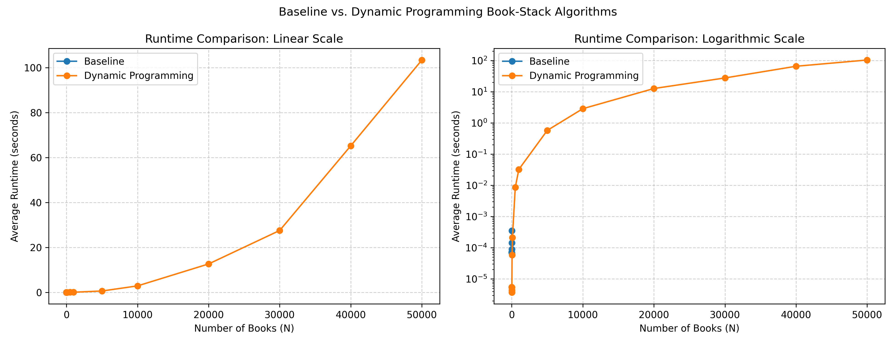

# Empirical Evaluation

## Overview

## Benchmark Results
`benchmark.py` generates an array of random integer file sizes from 1 through 100 (`L = 100`) for each configured number of files. The benchmark varies the number of files from 10 to 50,000 and runs both algorithms five times on the same generated array at each applicable input size. Execution time is measured with `perf_counter()` only for the ordering algorithm calls; input generation and CSV writing occur outside the timed section. These measurements represent algorithm runtime rather than the time required to process actual files.

The baseline is restricted to 10 files because its factorial runtime makes larger inputs impractical. Since 10 is the smallest benchmark input size, the recorded results contain one baseline size. The baseline and dynamic programming algorithm are evaluated using the same 10-file array.

The table below reports the arithmetic mean of the five recorded runtimes in [`empirical_results.csv`](../assets/empirical_results.csv):

| Number of files (n) | Baseline mean time (seconds) | Dynamic mean time (seconds) |
| ------------------: | ---------------------------: | ------------------------: |
|                  10 |                  1.838299767 |               0.000003142 |
|                  50 |                           -- |               0.000003142 |
|                 100 |                           -- |               0.000003142 |
|                 500 |                           -- |               0.000003142 |
|               1,000 |                           -- |               0.000003142 |
|               5,000 |                           -- |               0.000003142 |
|              10,000 |                           -- |               0.000003142 |
|              20,000 |                           -- |               0.000003142 |
|              30,000 |                           -- |               0.000003142 |
|              40,000 |                           -- |               0.000003142 |
|              50,000 |                           -- |               0.000003142 |

A dash indicates that the baseline was not measured at that input size.

## Test Suite

1. Standard sequence of increasing energies: Tested the input of available books from a random, mixed sequence of energy to the input [2, 5, 3, 8, 6]. The output changes to a maximum height of 3, with the selected books being [2, 5, 8] which simply ensures that the algorithm is selecting the correct books in increasing order of energy of which are available.

2. Input of an empty sequence/no books available: Tested in case the input was changed to an empty sequence [], which makes the output result in a maximum height 0 and the selected books stays as [], verifying that the base case works being 0 books available.

3. Standard sequence of decreasing energies: Tested the input of energies as [9, 7, 5, 3, 1], which makes output change to a maximum height of 1, and it selected the single book with the highest energy being [9] as it can't go to lower energies coming after that.

4. Multiple of the same energies available: Tested the input as [4, 4, 4, 4]. Since the books next to each other must be of strictly increasing energy, the output stays at a maximum height of 1, with the one selected book being any of the available since they are all the same at a value of [4].

5. Negative energies or completely unsorted: Tested the input as [-5, -2, -8, 0, -1] which includes negative values to see how they would be handled. The output results as a maximum height of 3, with the selected books for that height being [-5, -2, 0], meaning it handles negative numbers correctly and still selects the correct books in increasing order of energy with higher negative values (ex. -5) being treated as lower energy than lower negative values (ex. -2).

## Analysis