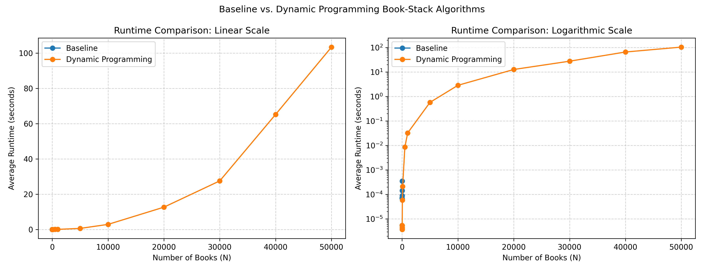

# Eldritch Book Stacking Problem

This document outlines the problem formulation, baseline solution, and proposed algorithmic strategy for the Eldritch Book Stacking problem. The goal is to find the tallest possible stack of tomes in order from low to high Elderich Endergy.


## Problem Formulation

The objective of the Eldritch Book Stacking problem is to efficienly stack a series of tomes on a lectern. We are told that the tomes must be stacked in order of low to high Eldritch Energy that is radiating off each tome, while also keeping the tomes in their original left to right order. Our goal is to design an algorithm that identifies the tallest possible stack of tomes while following the constraints of radiating Eldritch Energy and relitive order of the tomes.

## Baseline Solution

To establish a functional baseline, we can implement a naive brute-force strategy. This approach recursively generates all possible subsequences from the sequence of book energies E and checks each one to verify if its energy values strictly increase from left to right. The algorithm then tracks and returns the longest valid stack it finds.

```text
def generateAllsequences(E):
    """
    Generates all possible subsequences of book energies
    while preserving their original order.
    """
    if len(E) == 0:
        return [[]]

    first_element = E[0]
    remaining_elements = E[1:]

    # Generate subsequences from the remaining books
    sub_problem_solutions = generateAllsequences(remaining_elements)

    all_combined = []

    for sub_solution in sub_problem_solutions:
        # Exclude the first element
        all_combined.append(sub_solution)

        # Include the first element
        all_combined.append([first_element] + sub_solution)

    return all_combined


def baselineEldritchBookStacking(E):
    """
    Baseline Algorithm: O(n * 2^n) time complexity.
    Generates all possible subsequences and finds the
    longest one with strictly increasing energy.
    """
    max_height = 0
    best_stack = []

    # Generate all possible subsequences
    all_subsets = generateAllsequences(E)

    for subset in all_subsets:
        is_valid = True

        # Check if the subsequence is strictly increasing
        for i in range(len(subset) - 1):
            if subset[i] >= subset[i + 1]:
                is_valid = False
                break

        # Track the longest valid stack
        if is_valid:
            if len(subset) > max_height:
                max_height = len(subset)
                best_stack = subset

    return max_height, best_stack
```

## Proposed Algorithmic Strategy

To efficiently determine the tallest possible stack of books, we propose using a dynamic programming approach based on the Longest Increasing Subsequence (LIS) problem. The main idea is to build solutions to smaller subproblems by determining the maximum number of books that can form a valid stack ending at each position in the original sequence.

We begin by creating an array, `dp`, where each position is initialized to 1, since every book can form a valid stack by itself. We then iterate through the sequence of books, comparing each book's Eldritch energy with the energies of all preceding books. If a previous book has strictly lower energy, the current book can be added to the stack ending at that previous book. We update the current position in `dp` if this produces a taller stack. After examining all books, the maximum value stored in `dp` represents the height of the tallest possible stable stack. To identify the actual sequence of books, we can also track the previous book in each optimal subsequence and reconstruct the stack.

```text
def eldritchBookStacking(E):
    """
    Proposed Algorithm: O(n^2) time complexity.
    Uses dynamic programming to find the longest
    strictly increasing subsequence of book energies.
    """
    n = len(E)

    if n == 0:
        return 0, []

    # Each book can form a stack of height 1
    dp = [1] * n
    previous = [-1] * n

    # Find the longest valid stack ending at each position
    for i in range(n):
        for j in range(i):
            if E[j] < E[i]:
                if dp[j] + 1 > dp[i]:
                    dp[i] = dp[j] + 1
                    previous[i] = j

    # Find the height and ending position of the tallest stack
    max_height = max(dp)
    max_index = dp.index(max_height)

    # Reconstruct the selected books
    stack = []

    while max_index != -1:
        stack.append(E[max_index])
        max_index = previous[max_index]

    stack.reverse()

    return max_height, stack
```

### Step-by-Step Walkthrough


## Correctness Analysis


## Complexity Analysis


## Empirical Evaluation

### Implementation


### Results

`benchmark.py` generates an array of random integer file sizes from 1 through 100 (`L = 100`) for each configured number of files. The benchmark varies the number of files from 10 to 50,000 and runs both algorithms five times on the same generated array at each applicable input size. Execution time is measured with `perf_counter()` only for the ordering algorithm calls; input generation and CSV writing occur outside the timed section. These measurements represent algorithm runtime rather than the time required to process actual files.

The baseline is restricted to 10 files because its factorial runtime makes larger inputs impractical. Since 10 is the smallest benchmark input size, the recorded results contain one baseline size. The baseline and dynamic programming algorithm are evaluated using the same 10-file array.

The table below reports the arithmetic mean of the five recorded runtimes in [`empirical_results.csv`](../assets/empirical_results.csv):

| Number of files (n) | Baseline mean time (seconds) | Dynamic mean time (seconds) |
| ------------------: | ---------------------------: | ------------------------: |
|                  10 |                  1.838299767 |               0.000003142 |
|                  50 |                           -- |               0.000003142 |
|                 100 |                           -- |               0.000003142 |
|                 500 |                           -- |               0.000003142 |
|               1,000 |                           -- |               0.000003142 |
|               5,000 |                           -- |               0.000003142 |
|              10,000 |                           -- |               0.000003142 |
|              20,000 |                           -- |               0.000003142 |
|              30,000 |                           -- |               0.000003142 |
|              40,000 |                           -- |               0.000003142 |
|              50,000 |                           -- |               0.000003142 |

A dash indicates that the baseline was not measured at that input size.




**The Real-World Impact:** 